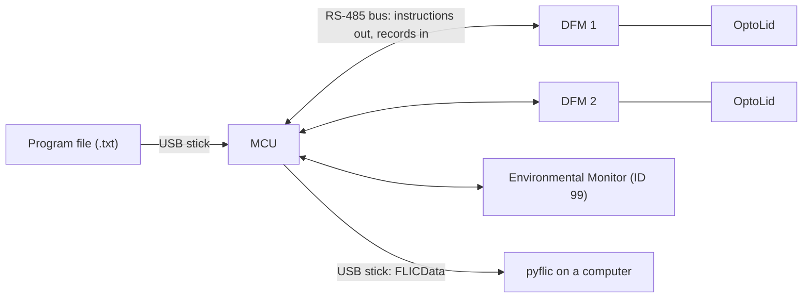

# FLIC User Guide

PyMCU 4.0 with DFM firmware 4.0 and pyflic. Last updated: 2026-10-18.

This guide takes you through a FLIC experiment from start to finish: setting up the DFMs, running a Program on the MCU, watching it run, collecting the data and analysing it in pyflic. For each step it says what to do and also what the MCU and the DFMs do in response, so you know what to expect and why.

It is written for the people who run experiments. The details are in other documents, linked where they matter:

| For | See |
|---|---|
| Writing Program files, every setting | [ProgramFormat.md](ProgramFormat.md) |
| Every column of the data files | [DataFileColumns.md](DataFileColumns.md) |
| Which DFM firmware runs what | [FirmwareCompatibility.md](FirmwareCompatibility.md) |
| Installing an MCU software update | [Updating.md](Updating.md) |
| Setting up a new MCU | [MCUSetup.md](MCUSetup.md) |
| Exact meanings of the terms | [../CONTEXT.md](../CONTEXT.md) |
| DFM firmware, ID dials, flashing | `README.md` and `ID_DIALS.md` in the DFMV3_V2 repository |
| Analysis | pyflic's built-in help (F1, or `pyflic help`) and its `docs/GETTING_STARTED.md` |

Questions and suggestions: Scott Pletcher (spletch@umich.edu).

## Contents

1. [The FLIC system](#1-the-flic-system)
2. [Words used in this guide](#2-words-used-in-this-guide)
3. [Before you start](#3-before-you-start)
4. [A tour of the MCU screen](#4-a-tour-of-the-mcu-screen)
5. [Step 1: Find the DFMs](#5-step-1-find-the-dfms)
6. [Step 2: Check each DFM on the Live Data page](#6-step-2-check-each-dfm-on-the-live-data-page)
7. [Step 3: Choose or write a Program](#7-step-3-choose-or-write-a-program)
8. [Step 4: Put the Program on the MCU and load it](#8-step-4-put-the-program-on-the-mcu-and-load-it)
9. [Step 5: Set the start time and run](#9-step-5-set-the-start-time-and-run)
10. [Step 6: Watch the experiment](#10-step-6-watch-the-experiment)
11. [Step 7: Get the data off the MCU](#11-step-7-get-the-data-off-the-mcu)
12. [Step 8: Analyse the data in pyflic](#12-step-8-analyse-the-data-in-pyflic)
13. [Settings and maintenance](#13-settings-and-maintenance)
14. [Troubleshooting](#14-troubleshooting)
15. [Appendix: a demonstration session](#15-appendix-a-demonstration-session)

## 1. The FLIC system

FLIC (the Fly Liquid-food Interaction Counter) measures feeding. Each Well holds a drop of liquid food. When a fly touches the food, the Well's electrical signal rises, so a recording of the signal shows when, how often and for how long each fly fed. With an OptoLid on top, every Well also has its own LED, which can be switched on in response to what the fly does. This lets an experiment deliver optogenetic light as a reward or a punishment for feeding.

### The parts

| Part | What it is | What it does |
|---|---|---|
| **DFM** | A feeding monitor board with twelve Wells, in six chambers of two | Measures every Well's signal hundreds of times a second, decides every millisecond whether each Well's LED should be on, and stores a Status record every 200 ms until the MCU collects it |
| **OptoLid** | The lid with one LED above each Well | Delivers the light the DFM switches on |
| **Environmental Monitor** | A board with ID 99 | Measures temperature, humidity and light, and can switch two relays and four outputs on a schedule |
| **MCU** | A Raspberry Pi with a touch screen, running PyMCU | Runs the Program's schedule, tells each DFM which rule to follow and when, collects the records and writes the data files |
| **Bus** | One RS-485 cable shared by all the DFMs and the Environmental Monitor | Carries the MCU's requests and the DFMs' replies. The MCU talks to one board at a time, by its ID |
| **USB stick** | Any stick, with the right folders on it | Carries Programs to the MCU, data from it and software updates to it |
| **pyflic** | Analysis software for a Windows, Mac or Linux computer | Finds feeding bouts, checks the data and the light, and writes summary tables, plots and reports |



### Who decides what

It helps to know which part makes each decision, because it explains how the system behaves when something goes wrong.

- **The DFM decides the light.** It compares each Well's signal with its Threshold every millisecond and switches the LEDs by the rule (the Paradigm) it was last given. The MCU never switches an LED itself. If the MCU is slow or the bus is briefly disconnected, the light keeps following the fly.
- **The MCU decides the schedule.** It sends each DFM an instruction when an Interval starts: which Paradigm, which Thresholds, and whether the indicator LEDs are dark. A DFM changes Interval only when the MCU tells it to.
- **The DFM keeps its records until the MCU confirms it has them.** It holds the most recent 780 records, about 2.6 minutes. The MCU collects them every 4 seconds and acknowledges each reply; records that weren't acknowledged are sent again.
- **pyflic decides what counts as feeding,** from the recorded signals, with its own settings. The DFM's Thresholds only control the light.

### The workflow

1. Set the DFMs' IDs, connect them and power everything on ([section 3](#3-before-you-start)).
2. **Find DFM** on the MCU ([section 5](#5-step-1-find-the-dfms)).
3. Check each DFM's signals and LEDs ([section 6](#6-step-2-check-each-dfm-on-the-live-data-page)).
4. Choose a simple recording or write a Program ([section 7](#7-step-3-choose-or-write-a-program)).
5. Copy the Program to the MCU and **Load** it ([section 8](#8-step-4-put-the-program-on-the-mcu-and-load-it)).
6. Set the start time and press **Run Program** ([section 9](#9-step-5-set-the-start-time-and-run)).
7. Watch the experiment ([section 10](#10-step-6-watch-the-experiment)).
8. **Export Data** to a USB stick ([section 11](#11-step-7-get-the-data-off-the-mcu)).
9. Analyse the recording in pyflic ([section 12](#12-step-8-analyse-the-data-in-pyflic)).

## 2. Words used in this guide

These words have exact meanings, shared by Program files, the MCU, the DFM firmware, the data files and pyflic. The full list is in [CONTEXT.md](../CONTEXT.md).

| Word | Meaning |
|---|---|
| **Well** | One feeding site. The twelve Wells are named 1A, 1B, 2A, 2B … 6A, 6B and numbered 1 to 12 in that order, so Well 1 is 1A and Well 2 is 1B. |
| **Chamber** | One row of a DFM: Wells nA and nB. In a choice (two-well) experiment one fly has both Wells; in a single-well experiment each Well has its own fly. |
| **Signal** | A Well's reading, 0 to 1023. It rises when a fly touches the food. |
| **Baseline** | A Well's resting signal, measured in the first seconds of a recording. With `Baseline: Yes`, Thresholds are measured from it. |
| **Threshold** | The signal level above the baseline at which a Well counts as in contact with the food. Instead of a Threshold, a Well can be set `On` (lit for the whole Interval) or `Off` (never lit by its own feeding). |
| **Event** | One feeding bout. It ends once the signal has stayed below the Threshold for the Event gap (100 ms unless set), so a fly dipping in and out counts once. |
| **Activation** | One period during which a Paradigm lights a Well's LED. |
| **Paradigm** | A named rule, defined in the Program, for when a Well's LED turns on: open loop, closed loop, fixed interval, non-feeding, progressive ratio or fixed ratio. |
| **Interval** | One timed step of a DFM's Program, with its Paradigm, its Thresholds and its length. |
| **Cycle** | One pass through a repeating Program's Intervals. |
| **Linkage** | Wells grouped so that their LEDs light together. |
| **Acclimation** | An optional start to a Paradigm in which each Well gets a set number of simple closed-loop Activations. A Well's **Phase** is Acclimation or Main. |
| **Requirement, Progress** | For ratio Paradigms: how many Events a Well needs for its next Activation, and how many it has so far. |
| **Status record** | What a DFM reports for every 200 ms: the twelve signals, the LED state and each Well's Paradigm state. One record is one row of the data file. |

## 3. Before you start

### 3.1 DFMs

**IDs.** Every board on the bus needs its own ID, set on the DFM's two rotary dials: tens and ones, so dials at 1 and 2 give ID 12.

- DFMs use IDs 1 to 98. ID 99 is the Environmental Monitor, and ID 0 is never found.
- The dials are read only when the board powers up. After changing them, switch the DFM off and on again.
- If a board isn't found, or is found under the wrong number, run the 7-1 dial test in `ID_DIALS.md` (DFMV3_V2 repository): set the dials to 7 and 1, restart the board, and the ID the MCU finds tells you whether one of the dials is a type that needs a different firmware build.

**Firmware.** Every Paradigm type needs DFM firmware 4.0.0. Older boards still run open loop, closed loop and fixed interval, and (from firmware 2.0.0) non-feeding; the MCU refuses, before a Program starts, anything a board can't run. A DFM's firmware is shown on its page on the MCU (section 6). See [FirmwareCompatibility.md](FirmwareCompatibility.md) for the full table. Boards of different firmware can share a bus.

Installing firmware is a job for lab staff: it is built and flashed with MPLAB X and an MPLAB ICD 5 programmer, as the DFMV3_V2 `README.md` describes (Building). Power the board off and on after flashing.

**Indicator LEDs.** Four LEDs on the DFM board show what it is doing:

| LED | Meaning |
|---|---|
| Red | Heartbeat: blinks steadily while the firmware runs. If it stops outside a `Dark` Interval, the board has hung; power it off and on. |
| Green | Toggles each time the DFM handles a request addressed to it, so it flickers while the MCU is talking to it. |
| Blue | Comes on after an internal timing fault (the "AI Int" error, section 6) and stays on until the next restart. |
| Yellow | On means the board drives its OptoLid through the old connector, which only very old firmware does. |

An Interval set to `Dark` turns all four off, so they don't disturb the flies. The blue LED can still come on.

### 3.2 The MCU

A new MCU is set up once, by lab staff, following [MCUSetup.md](MCUSetup.md). After that it starts PyMCU full screen whenever it is powered on.

- **Clock.** Every time in the data comes from the MCU's clock. Check it on the status bar, and set it in Settings (section 13) if it is wrong. A clock battery keeps the time while the MCU is off.
- **Storage.** If less than 1 GB is free when PyMCU starts, it warns you. Export old recordings and delete them from the MCU (section 11).

### 3.3 A USB stick

The MCU looks for folders with these exact names at the top level of the stick:

| Folder | Used for |
|---|---|
| `FLICPrograms` | Program files (`.txt`) to copy to the MCU |
| `FLICData` | Receives the recordings when you export them. Create it empty before the first export. |
| `FLICUpdates` (or the top level) | One MCU software update file (`.mcu`) |

A stick without the needed folder is ignored for that action, so an unrelated second stick does no harm.

## 4. A tour of the MCU screen

The screen has a toolbar along the top, a page in the middle and a status bar along the bottom. The status bar shows the date and time on the right, and on the left a short message for a few seconds after each action, for example "3 DFMs found." or "USB connected...".

### The toolbar

| Button | What it does |
|---|---|
| **Live Data** | Shows the DFM page: the live signals and status of one DFM (section 6). |
| **Programs** | Shows the Program page: the loaded Program, its start time and the run button (sections 7 to 9). |
| **Messages** | Shows the Messages page: what the MCU and the DFMs have reported (section 10). |
| **Clear Msg** | Clears the messages on screen, after asking. |
| **Find DFM** | Searches the bus for DFMs and the Environmental Monitor (section 5). |
| **Clear DFM** | Disconnects from all the boards: stops reading them, forgets them and the loaded Program, and clears the messages. Use it before **Find DFM** when you have added, removed or renumbered a board. |
| **Export Data** | Copies every recording on the MCU to a USB stick (section 11). |
| **Delete Data** | Deletes every recording on the MCU, after asking twice. |
| **Outputs** | Switches all twelve LEDs of the DFM on screen on, or off again, to test its OptoLid (section 6). |
| **Power Off** | Shuts the MCU down, after asking twice. Wait for the screen to go dark before unplugging it. |
| **About** | Shows the PyMCU version, network address, free storage and clock, and opens Settings (section 13). |

While a Program is running, everything that could disturb it is locked: Clear Msg, Clear DFM, Delete Data, Outputs, Power Off, Export Data, the Program buttons and Settings. **Stop Program** and the pages stay available.

## 5. Step 1: Find the DFMs

**Do:** power on the DFMs and the Environmental Monitor, wait a few seconds for them to start, then press **Find DFM**.

**What happens:**

1. The MCU clears the messages and asks every ID from 1 to 99 in turn whether a board is there. This takes several seconds.
2. Each board that answers gets a button on the left of the Live Data page, `DFM 1`, `DFM 2` and so on, or `EnvMon` for the Environmental Monitor, and a message such as "DFM 1 found".
3. The MCU asks each DFM for its firmware version. This decides how the MCU talks to that board and what its error boxes mean. Boards with firmware 1.0.5 can't answer, so they are shown as `1.0.5`.
4. A simple 3-hour recording with every LED off is loaded, starting at the next minute, so a recording can be started straight away.
5. The Live Data page opens on the first board. From now until a recording starts, the MCU reads only the board on screen, a few times a second, so its display stays live.

The status bar ends with "N DFMs found." If it says "No DFMs found.", check the power, the bus cable and the IDs, then press **Find DFM** again.

**Find DFM** stays greyed out once boards are found. To change the set of boards, press **Clear DFM**, then **Find DFM**.

## 6. Step 2: Check each DFM on the Live Data page

Before an experiment, look at every DFM: its signals should be steady at rest, its LEDs should light, and its firmware should run your Program.

**Do:** tap a DFM's button on the left. Its label turns bold and the page shows that board. The MCU starts reading it instead of the previous one.

The button's colour shows the board's state:

| Colour | Status | Meaning |
|---|---|---|
| Black (white in the dark theme) | Read | Being read, no recording |
| Green | Rec | Recording |
| Red | Error | The last reply was damaged. The DFM will send the records again. |
| Blue | Miss | The board didn't answer |

### The plot

The plot has one column per chamber, Row 1 to Row 6. The blue dot is the chamber's A Well and the red dot its B Well, and the height is the Well's signal.

- At rest a Well sits low and steady. When a fly feeds, or you touch the food, its dot jumps up, and falls back when contact ends.
- The scale runs from 0 to 1000. Tick **Zoom Plot** to show 0 to 100, for checking small resting levels.
- During a recording with `Baseline: Yes`, the plot shows the signal above each Well's baseline, which is what the Thresholds are compared with.

### The panels on the right

**Environment** shows the Environmental Monitor's Temperature, Humidity and LUX (greyed out when there is none) and the DFM's own Input Voltage.

**Status:**

| Row | Shows |
|---|---|
| Dark Mode | `Yes` while the DFM's indicator LEDs are switched off by a `Dark` Interval |
| Paradigm | The name of the Paradigm the DFM is running. Its tooltip lists all its settings. `Idle` means every LED off. |
| Type | The Paradigm type, for example ClosedLoop |
| Interval | Which Interval of the Program is running, and its Cycle, for example `2 (Cycle 1)`. `-` outside a Program. |
| Status | Read, Rec, Error, Miss, or None |
| Past Status | `Error` if the board has been in Error or Miss since it was found or the recording started, otherwise `Clear` |
| Firmware | The DFM's firmware version |

**DFM Indicators** are the DFM's error flags. A box is ticked once its flag has been raised since the DFM was found or the recording started, so a tick tells you something happened even if it has stopped. Each box's tooltip explains it.

| Box | Meaning | What to do |
|---|---|---|
| No Ack | The DFM didn't receive the MCU's acknowledgement for a reply, so it sent those records again. The MCU saved them the first time, so nothing is lost. | Nothing, unless it is ticked constantly |
| Overflow | The DFM's store of 780 records filled up before the MCU collected them, and the oldest were overwritten. Records were lost. (Firmware 3.5.0 and later.) | Check the bus cable; Messages says which records |
| P Type | A request had an unknown command | Report it if it recurs |
| DMA Tx, DMA Rx | Errors sending or receiving on the bus. The DFM recovers by itself. | Check the cable if it recurs |
| P Size | A request had the wrong length, usually from noise on the bus | Check the cable if it recurs |
| AI Int | Signal readings arrived before the last ones were used (also lights the blue LED) | Report it |
| O Int | The DFM's 1 ms clock ticked before it had finished the last millisecond | Report it |

Firmware older than 3.5.0 has no Overflow flag and reports a missed acknowledgement differently, so its page shows seven boxes.

### Well details

Tick **Well details** to replace the plot with a table of the twelve Wells, from the DFM's latest record (firmware 4.0.0 only):

| Column | Shows |
|---|---|
| Phase | Acclimation or Main |
| Activations | The Well's Activations since the recording started |
| Requirement, Progress | For ratio Paradigms: Events needed for the next Activation, and Events so far |
| On ms | How many of the last 200 ms the Well's LED was lit, whatever lit it |

### Testing the LEDs with Outputs

**Do:** with no Program running, press **Outputs**. Press it again to switch off.

**What it does:** sends the DFM on screen an instruction that sets all twelve Wells `On`, so every LED of its OptoLid lights at once. Use it to check that the OptoLid is connected and every LED works. It affects only the board on screen. Starting a Program replaces it.

## 7. Step 3: Choose or write a Program

A Program says how long to record and what each DFM's LEDs should do, and when.

### Simple recordings without light

The Program page has buttons for **30 min**, **60 min**, **3 hours**, **6 hours**, **12 hours**, **24 hours** and **5 days**.

**What they do:** load a built-in Program that records every DFM for that long, starting at the next minute, with every LED off. Use them for plain feeding experiments. The Program page then shows it as `***ALL DFM***`, with one Interval, `Lit, Idle`, and every Well `Off`.

### Custom Programs

For light, write a Program file: a plain text file (`.txt`), for example in Notepad. Here is a complete one for choice chambers, where feeding from the A Well lights both LEDs of its chamber:

```
# Six hours of closed loop. Feeding from an A well lights both LEDs in its chamber.
[General]
ExpDurationMin: 360
Linkage: 1,1,2,2,3,3,4,4,5,5,6,6
Baseline: Yes

[Paradigm Closed]
Type: ClosedLoop
HoldMs: 500

[DFM]
ID: 1
Interval: Closed, Dark, 20,Off,20,Off,20,Off,20,Off,20,Off,20,Off, 360
```

- `[General]` sets the length (360 minutes), the Linkage (Wells 1 and 2 light together, 3 and 4, and so on) and baselining.
- `[Paradigm Closed]` defines a rule named `Closed`: the LED is lit while the fly is in contact with the food and for 500 ms after.
- `[DFM]` says what DFM 1 does: for 360 minutes, follow `Closed`, with the indicator LEDs `Dark`. The twelve Thresholds, in Well order 1A, 1B, 2A … 6B, are 20 for each A Well and `Off` for each B Well.

The six Paradigm types:

| Type | What the light does | Firmware |
|---|---|---|
| OpenLoop | On for the whole Interval, whatever the fly does | Any |
| ClosedLoop | On during contact and for `HoldMs` after it, optionally cut off after `MaxOnMs` | Any |
| FixedInterval | Contact gives exactly `ActivationMs` of light, then none until `LockoutMs` after it started | Any |
| NonFeeding | Off during contact; on again `OnDelayMs` after contact ends | 2.0.0 and later |
| ProgressiveRatio | Each Activation needs more feeding bouts than the last | 4.0.0 |
| FixedRatio | Every `Ratio`-th feeding bout gives `ActivationMs` of light | 4.0.0 |

FixedInterval and the two ratio types can start with `Acclimation: N`: each Well's first N Activations are closed loop, so the fly learns that feeding brings light.

A DFM can step through several Intervals, each with its own Paradigm and Thresholds, and a Program can run them once (`Linear`), over and over (`Repeating`), on a 24-hour clock (`Circadian`) or run only the first (`Constant`). A Well keeps its progress (for example its progressive-ratio Requirement) when the next Interval names the same Paradigm, and starts fresh when it names a different one.

Everything about writing Programs, with a worked example of every type, is in [ProgramFormat.md](ProgramFormat.md). Programs written for PyMCU 3.x still load, apart from the old progressive ratio and training count, which have to be rewritten as that guide explains.

**Ready-made Programs** are in the `FLICPrograms` folder of the PyMCU repository:

| Program | Use |
|---|---|
| `OptoTest1_OpenLoop` … `OptoTest6_TrainingFirst` | Ten minutes of one Paradigm type on every connected DFM, with Thresholds 50 above baseline. Touch a Well to see the rule work; the comment at the top of each file says what to expect. |
| `OptoLidOutputTest` | Lights each LED alone in Well order, then all off, then all on, repeating, to check an OptoLid |
| `ParadigmExamples` | One DFM per Paradigm type, as a template |

## 8. Step 4: Put the Program on the MCU and load it

**Do:**

1. Copy the Program file into the `FLICPrograms` folder of a USB stick.
2. Plug the stick into the MCU. The status bar shows "USB connected...".
3. Press **Programs**, then **Custom**. This opens the Program files page: the files on the MCU on the right, a preview on the left.
4. Press **Get (USB)**.
5. Tap the file in the list and check the preview.
6. Press **Load**.

**What each button does:**

| Button | What it does |
|---|---|
| **Get (USB)** | Copies every `.txt` file from the stick's `FLICPrograms` folder into the MCU's own Program folder, replacing files of the same name, and refreshes the list. The files stay on the MCU, so next time you can load them without the stick. |
| *(tapping a file)* | Shows its contents in the preview |
| **Refresh** | Reads the list of files on the MCU again |
| **Delete** | Deletes the chosen file from the MCU, after asking. The copy on the stick is untouched. |
| **Load** | Reads the chosen file, checks every line, and makes it the Program to run |

**When you press Load,** the MCU checks the whole file before using any of it:

- **If anything is wrong,** nothing is loaded, and a message names the file, the line and the problem, for example `Line 14: ClosedLoop Paradigms don't use Step`. A misspelled setting is an error, never ignored. Fix the file and load it again.
- **If the file is good,** the Program page opens and shows the Program as the MCU understood it: start and end time, duration, Linkage, every Paradigm with all its settings (including defaults you didn't write), and each DFM's Intervals with the time each is due to start. Read it: this is exactly what will run, and it is saved with the data as `Program.txt`.
- **Then the MCU checks the Program against each DFM it found.** If a board's firmware can't run something in the Program, a Compatibility Check box lists the board, its firmware and the reason, for example `DFM 5 (firmware 3.5.0) can't run: the ProgressiveRatio Paradigm type needs firmware 4.0.0`. The Program won't start until the board is updated, removed, or the Program changed.

A DFM that is connected but has no section in the Program (and no `ID: All` section) records with every LED off.

Find the DFMs (section 5) before you load a Program, so that it can be checked against them.

## 9. Step 5: Set the start time and run

### The start time

- A Program file's `StartTime` setting sets it when the file loads. Without one, the Program starts at the beginning of the next minute after loading.
- **Now** sets the start to the beginning of the next minute.
- **Set** opens a calendar and clock to choose a date and time, always on a whole minute.

The first line of the Program description always shows the start time that will be used. If you loaded a Program some time ago, press **Now** before **Run Program**: a start time that has already passed starts the recording at once, but it still ends at the original end time, so the recording would be shorter than planned.

### Run Program

**Do:** press **Run Program**.

**What happens, in order:**

1. **The Program is checked again** against every DFM, because a board may have been swapped since the Program was loaded. If any board can't run it, a message lists them and nothing starts.
2. **The MCU gets ready.** Most buttons lock, the button changes to **Stop Program**, the Live Data page opens and the status bar says "Staging program." Until the start time, only the DFM on screen is read, so you can still watch it.
3. **At the start time, recording begins.** For every board, the MCU:
    - clears its messages and posts "Recording started";
    - sends each DFM a buffer reset, which sets its record counter, its Paradigm state and its Activation counts back to zero, so the recording starts clean;
    - sends each DFM its Linkage;
    - creates the recording folder, `FLICData/<MCU name>_<MM_DD_YYYY_HH_MM>`, writes `Program.txt` into it and opens one data file per board;
    - turns each board's button green (Rec) and starts reading every board, not just the one on screen.
4. **The baseline is measured** (with `Baseline: Yes`): each Well's first 10 records, 2 seconds of signal, are averaged. Each DFM's Thresholds are then set that far above its own Wells' resting levels, so a Threshold of 20 means "20 above where this Well rests". Until a DFM has its first instruction, its LEDs stay off, so every recording starts with about 5 seconds of dark, even under open loop. These records are marked Interval 0 in the data file.
5. **Each DFM is sent its first Interval:** the Paradigm, its settings, the Thresholds and Dark or Lit. From then on the DFM runs the light rule by itself, every millisecond. When an Interval ends, the MCU sends the next one. Each instruction is acknowledged by the DFM; if it isn't, the MCU tries again, and says so on the Messages page if it keeps failing.
6. **Records are collected.** Every 4 seconds the MCU asks each board for the records it has made since the last time, up to 27 records (5.4 seconds) per reply, and acknowledges the ones that arrived intact. The DFM deletes records only once they are acknowledged, and sends any others again. A board that has more waiting is asked again at once.
7. **Records are written.** Every 10 seconds each board's records are added to its data file, and `Messages.csv` is updated. After 12 hours a new data file is started (`DFM1_1.csv`, then `DFM1_2.csv` …).

### Stopping

The Program stops by itself at its end time. To end it early, press **Stop Program**. Either way:

1. Every board is read one last time, the remaining records are written, the files are closed and "Recording ended" is posted.
2. Every DFM is sent an instruction with all LEDs off. A board that doesn't acknowledge it is named on the Messages page, and the MCU keeps trying.
3. The buttons unlock and the button reads **Run Program** again.

## 10. Step 6: Watch the experiment

### On the Live Data page

- Every board's button should be green (Rec).
- **Interval** shows the step each DFM has reached, and **Paradigm** and **Type** what it is running.
- **Well details** shows each Well's Activations, Phase and, for ratio Paradigms, Requirement and Progress.
- During a recording the display updates every 4 seconds, when the board is read. Tick **Fast updates** to read every board every 0.3 seconds instead, for a smooth live view. It doesn't change what is recorded: every record is collected either way. It switches off when the Program ends.

### On the Messages page

Each line reads `(number) date time -> board <- message (type)`. The board is the DFM's ID, 99 for the Environmental Monitor, or 0 for the MCU itself.

| Type | Examples | Meaning |
|---|---|---|
| Unknown | Recording started, Recording ended, DFM 3 found | Markers, not problems |
| Notice | Records were sent again after a missed ACK; they were already saved | Informational: nothing was lost |
| Warning | An error code from the Environmental Monitor | Something to look at |
| Error | Lost N records (S s): Index A to B, from HH:MM:SS; an instruction not acknowledged; a data file write failed | Data or light may be affected |

A message that repeats within 10 minutes is shown once, ending "(repeated N more times, the last at HH:MM:SS)". The same list is saved with the data as `Messages.csv`. The list on screen is cleared when the DFMs are found and when a recording starts.

### What the system survives

| What happens | Effect |
|---|---|
| The MCU is busy, or a reply is damaged | Nothing lost. The DFM keeps its records until they are acknowledged and sends them again. No Ack may be ticked. |
| The bus is disconnected for less than about 2.6 minutes | Nothing lost. The light keeps following the flies; when the bus is back, the DFM sends what it stored. |
| The bus is disconnected for longer | The oldest records are overwritten. Overflow is ticked, the data file has a gap in its `Index` column, and Messages reports the missing records. An Interval change due during the outage happens when the bus is back. |
| A DFM loses power and restarts | Its records restart; the MCU keeps the times and `Index` continuous, reports the restart and the missing range, and sends the DFM its Interval and Linkage again. The DFM's Paradigm state starts again, but its Activation totals in the file carry on. |
| The MCU loses power | The recording stops, and at most the last 10 seconds of acknowledged records are lost. The DFMs keep running their last Interval's light rule, unrecorded. Power the MCU on, **Find DFM** and start a new recording; it goes in a new folder. |

## 11. Step 7: Get the data off the MCU

### Export Data

**Do:** plug in a USB stick with a `FLICData` folder, press **Export Data**, read the warning and press **Okay**. Wait for "Data copy complete. USB unmounted, ready to remove." before removing the stick.

**What it does:**

1. Copies every recording on the MCU, not just the last, into the stick's `FLICData` folder, replacing files of the same name. The Messages page opens, and the status bar shows the progress.
2. Writes everything to the stick and unmounts it, so it is safe to pull out.

If the copy fails, the reason is shown (for example "No space left on device"), the stick stays mounted, and you can try again. Export is locked while a Program runs.

### Delete Data

**Do:** after the data is safely on a stick and checked, press **Delete Data** and confirm twice.

**What it does:** deletes every recording on the MCU, to free its storage. It can't be undone.

### The recording folder

Each recording is one folder, named after the MCU and the start time, for example `FLICMCU_10_17_2026_09_30`:

| File | Contents |
|---|---|
| `DFM<ID>_0.csv` | One per DFM: one row for every 200 ms. After 12 hours a new file, `_1`, then `_2` … |
| `EnvMon_0.csv` | The Environmental Monitor's readings, if present |
| `Messages.csv` | Everything reported on the Messages page during the recording |
| `Program.txt` | The Program as the MCU understood it: every Paradigm with all its settings, and each DFM's Intervals with their start times |

Each DFM row has 90 columns:

- **27 original columns,** the same as in PyMCU 3.x: the date and time, a sample number, the twelve Well signals `W1` to `W12`, temperature, humidity, light, supply voltage, the Dark setting and light frequency and pulse width in force, which LEDs were on at that instant, the error flags, and `Index`, the DFM's record counter, which shows any lost records as a gap.
- **63 Paradigm columns,** filled by firmware 4.0.0 boards: `Interval`, `Cycle` and `Paradigm`, then for each Well its `Phase`, `Activations`, `Requirement`, `Progress` and `OnMs` (how many of the 200 ms its LED was lit).

A value that doesn't apply is written `NA`: Requirement and Progress outside the ratio Paradigms, and all 63 columns for boards with older firmware. The baseline records at the start have Interval 0. Every column is described in [DataFileColumns.md](DataFileColumns.md).

## 12. Step 8: Analyse the data in pyflic

pyflic is the lab's analysis software. It finds feeding licks and bouts in the Well signals, checks the data and the light, compares treatments and writes tables, plots and PDF reports. It runs on Windows, Mac and Linux, with a window-based Hub and a command line.

### Install

pyflic needs Python 3.13, which uv installs for it.

1. Install uv. On Windows, in PowerShell: `powershell -ExecutionPolicy ByPass -c "irm https://astral.sh/uv/install.ps1 | iex"`. On Mac or Linux: `curl -LsSf https://astral.sh/uv/install.sh | sh`.
2. Download pyflic as a ZIP from GitHub, or `git clone https://github.com/PletcherLab/pyflic.git`, into a folder such as `Documents/pyflic`.
3. In that folder, run `uv sync` once, to install what pyflic needs.
4. Start it with `uv run pyflic`. Update it later with `git pull` (or a new ZIP), then `uv sync`.

Data from PyMCU 4.0 needs a pyflic with PyMCU 4.0 support. Older pyflic versions read only the 27 original columns.

### Organise the recording

pyflic works on an **Experiment directory**: a folder with a `flic_config.yaml` file and a `data` folder. Put the recording's files in `data`:

- the `DFM<ID>_<n>.csv` files (pyflic joins the 12-hour files of each DFM in order);
- `Program.txt` and `Messages.csv`. **pyflic reads these only from `data`.** Without `Program.txt`, it can't tell which Wells were lit by which rule, and its light results are left blank.

Several experiments that belong together (different genotypes, say) form a **Project**: a folder with a `project.yaml` and one subfolder per experiment. The Hub can create both, and **File unfiled recordings** files a PyMCU recording folder that was copied in as it is. After filing, check that `Program.txt` and `Messages.csv` are in `data`, and move them there if not.

### Describe the experiment

`flic_config.yaml` tells pyflic what the chambers held. The main settings, all editable in the Hub's config editor:

| Setting | Says |
|---|---|
| `chamber_layout` | `single_well` (12 flies per DFM) or `two_well` (6 choice chambers per DFM) |
| `experiment_type` | `Custom`, `Hedonic`, `ProgressiveRatio`, or one the lab has defined. It sets which analyses run and what light pyflic expects. |
| `well_names` | What the A and B Wells held, for a choice experiment |
| `dfms` | For each DFM, the treatment in each chamber |
| `optogenetics` | `auto` (the default) treats the recording as optogenetic when `Program.txt` is present or an LED was lit |

Chambers to leave out go in `remove_chambers.csv`. `pyflic lint` checks the configuration.

### Run the analysis in the Hub

1. **Open Project** (or **Create project…**, or **Initialize existing directory…** for a folder of recordings). **Validate YAMLs** checks the configuration files.
2. Double-click an experiment. Its panels appear: **QC**, **Analyze**, **Plots**, **Scripts** and **AI**.
3. **Run QC**, then **Open QC Viewer**. Quality control checks the recording's integrity (lost records, DFM restarts and error flags, from `Messages.csv` and `Index`), shows the raw and baselined signals and the cumulative licks, flags simultaneous feeding from both Wells of a chamber, and checks every Activation against its Paradigm's rule.
4. **Run analysis.** pyflic subtracts a running baseline from each signal, finds licks and feeding events with its own thresholds, and computes, per chamber: licks, events, their durations and the time between them, and for choice chambers the preference index, (A − B) / (A + B). It adds statistics across treatments, time courses and, for optogenetic experiments, light exposure and Activations.
5. **Generate plots**, and at the Project level **Analyze all** and **Create report** for a PDF report of the whole Project.

Results go in an `analysis` folder (for example `feeding_summary.csv`, `summary.txt` and `experiment_report.pdf`) and quality-control output in a `qc` folder, both inside the experiment directory.

### How pyflic uses what the MCU and DFM recorded

- **Feeding is pyflic's own measurement.** It applies its own thresholds to the baselined Well signals (by default a feeding threshold of 20). The DFM's Thresholds in `Program.txt` decided only the light; pyflic uses them to tell which Wells were triggering, `On` or `Off`.
- **The DFM's own count of feeding bouts,** from `Progress` under the ratio Paradigms, is compared with pyflic's Events as a quality check.
- **Light exposure** comes from `OnMs`, which counts every millisecond an LED was lit, whatever lit it.
- **Activations, Phase, Requirement and Progress** give the light checks, the end of Acclimation and, for progressive ratio, the breakpoint.
- **Interval and Cycle** split the recording into Program steps (`ProgramInterval` in pyflic's output).
- **The data generation** is reported in `summary.txt` and on the report cover: 27 columns (PyMCU 3.x), 90 columns with `NA` (PyMCU 4.0 with older DFM firmware) or 90 columns filled (firmware 4.0.0).

### Help

Press F1 or a `?` button anywhere in pyflic, or run `pyflic help`, for its full documentation. Some tasks also have commands: `pyflic qc <dir>` opens the QC Viewer, `pyflic report <dir>` writes the report, `pyflic batch <dir>` analyses every Project in a folder, and `pyflic lint <dir>` checks the configuration.

## 13. Settings and maintenance

### About

Press **About** for:

- the MCU's model and the PyMCU version;
- its network address (IP), for remote support;
- free storage;
- the clock, and on a Pi 5 its battery: "Clock battery: 2.95 V, OK".

**Settings** opens the Settings page. It is locked while a Program runs.

### Settings

| Setting | What it does |
|---|---|
| **Set Date and Time** | Sets the MCU's clock and saves it to the battery-backed clock, so it is kept while the MCU is off |
| **Update MCU** | Installs a PyMCU update from a USB stick. The steps and messages are in [Updating.md](Updating.md). Your recordings and Programs are never changed. |
| **Use Dark Theme** | Light text on a dark background, from the next start |
| **Screen off after** | How long the screen stays on without a touch: − and + step from Never through 15 seconds to an hour. A touch wakes it. |

### Updating the DFMs

DFM firmware is updated by lab staff with MPLAB X and an MPLAB ICD 5 programmer (DFMV3_V2 `README.md`, Building). Check the new version on each DFM's page after **Find DFM**.

## 14. Troubleshooting

| Problem | Likely cause | What to do |
|---|---|---|
| "No DFMs found." | Boards not powered or still starting, bus cable loose, or IDs outside 1 to 98 | Check power and cable, wait a few seconds after power-on, press **Find DFM** again |
| A DFM is missing or has the wrong ID | Two boards share an ID, the dials were changed without a restart, or a dial needs a different firmware build | Give every board its own ID, power-cycle it, run the 7-1 dial test (`ID_DIALS.md`) |
| A DFM's button is blue (Miss) | The board stopped answering | Check its power and cable. Its records are kept for about 2.6 minutes. |
| "Program not loaded" | A mistake in the file | Fix the line named in the message ([ProgramFormat.md](ProgramFormat.md)) |
| The Compatibility Check lists a DFM | Its firmware can't run part of the Program | Update the board, unplug it, or change the Program ([FirmwareCompatibility.md](FirmwareCompatibility.md)) |
| LEDs don't come on | The first few seconds are always dark (baseline); the Threshold is too high; the Wells are `Off`; the OptoLid is unplugged | Wait 5 to 10 seconds, check the Program description, test with **Outputs** |
| LEDs are on all the time | `On` Wells, OpenLoop or NonFeeding, a Threshold too low, or `Baseline: No` with high resting signals | Check the Program description and the plot |
| No Ack ticked now and then | A reply or acknowledgement was missed and resent | Normal; nothing lost |
| Overflow ticked, or "Lost N records" | The board wasn't read for more than about 2.6 minutes | Check the bus cable and connectors |
| "No USB with a FLICData folder found." | The stick has no `FLICData` folder | Create it at the top level of the stick |
| Export Data or Update MCU is greyed out | No stick, a Program is running, or a copy is in progress | Plug in the stick; wait for the Program to end |
| The time is wrong after a power-off | The clock battery is flat or missing | Set the time in Settings; replace the battery |
| pyflic shows no Paradigm columns | An old pyflic, or the DFM's firmware is older than 4.0.0 | Update pyflic; check the DFM's firmware |
| pyflic's light results are blank | `Program.txt` isn't in the experiment's `data` folder | Move it there and analyse again |

For support, the MCU keeps a log at `~/PyMCU/mcu.log`, which lab staff can read remotely.

## 15. Appendix: a demonstration session

This order shows every feature in about half an hour, using one or more DFMs with firmware 4.0.0 and an OptoLid, a USB stick with `FLICPrograms` (holding the `OptoTest` Programs) and an empty `FLICData` folder, and a computer with pyflic.

1. **Power on.** The MCU starts PyMCU full screen. Point out the toolbar, the page and the status bar (section 4).
2. **Find DFM.** Watch the board buttons appear and the "found" messages. Open **Messages** to show them (section 5).
3. **Live Data.** Touch a Well and watch its dot rise; tick **Zoom Plot**. Read the Status panel: the firmware version, and the Paradigm `Idle` (section 6).
4. **Outputs.** All twelve LEDs light; press again to switch them off.
5. **Load a Program.** Plug in the stick, **Programs → Custom → Get (USB)**, tap `OptoTest2_ClosedLoop`, read its comment in the preview, **Load**. Read the Program description (section 8).
6. **Run it.** **Now**, then **Run Program**. At the start of the minute the button turns green; after about 5 seconds of baseline the Status panel shows Paradigm `Closed`, Interval `1 (Cycle 1)`.
7. **Show the rule.** Touch a Well: its LED lights, and stays on 1 second after you let go. Hold it: the LED goes off after 5 seconds and stays off until you let go and touch again. Tick **Well details** and watch Activations and On ms count up; tick **Fast updates** for a smoother view (section 10).
8. **Stop Program.** Show "Recording ended" on the Messages page.
9. **Export Data.** Wait for "USB unmounted, ready to remove" (section 11).
10. **On the computer,** open the recording folder: the data file in a spreadsheet, `Program.txt` and `Messages.csv`. Then in pyflic, put it in an experiment directory, **Run QC**, open the QC Viewer, **Run analysis** and open the report (section 12).

For the other Paradigm types, repeat steps 5 to 8 with `OptoTest3` to `OptoTest6`; the comment at the top of each says what to show. To demonstrate the analysis of a full progressive-ratio experiment without flies, `scripts/simulate_recording.py` in the PyMCU repository writes a realistic two-hour recording, exactly as an MCU would, together with a record of every simulated bout and Activation to check the analysis against.
